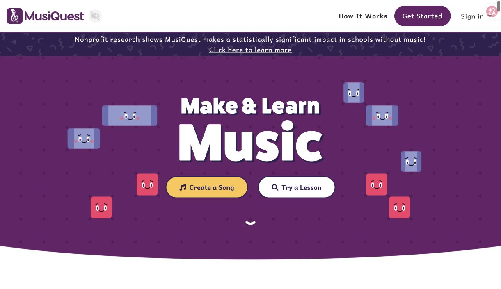
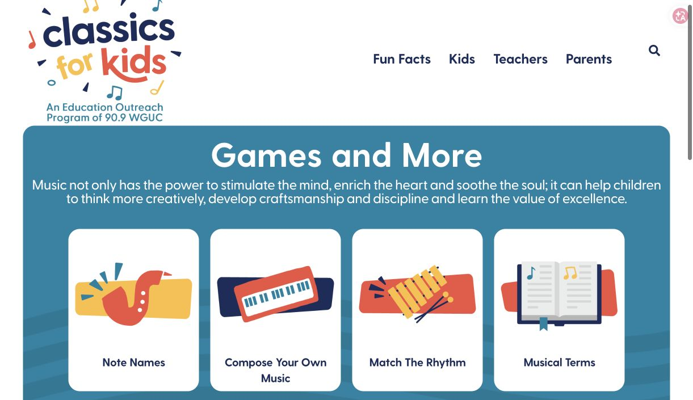
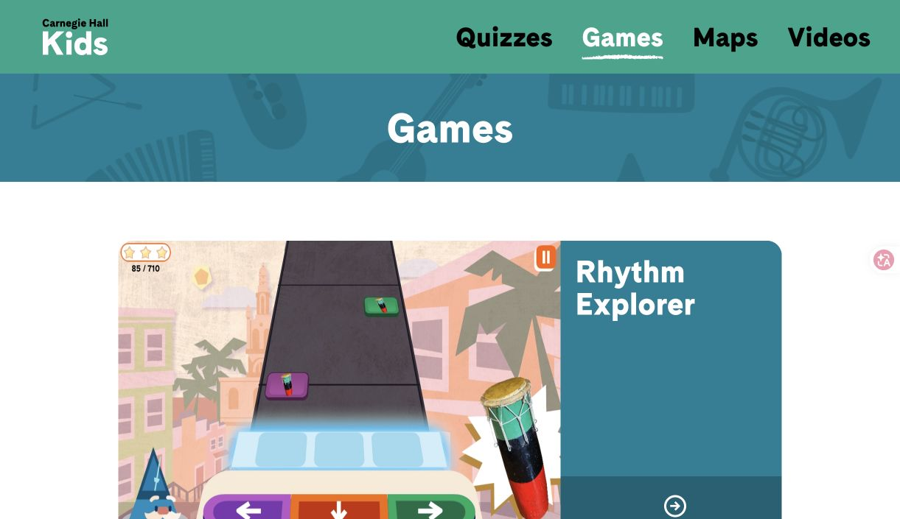

# 竞品研究：古典音乐探索如何形成连续体验

**MaestroMate｜第一阶段研究｜研究初稿**  
功能记录：2026-10-15；截图：2026-10-16；表达与结构修订：2026-10-28。依据公开页面与界面观察，未完成所有产品的完整交互测试。

## 一、现有产品提供了哪些学习入口

MaestroMate 计划结合历史音乐家对话、艺术化欣赏和主动聆听活动。本次选取五个相关产品，比较它们怎样引导初学者进入音乐、组织内容并提供反馈。下表中的局限指向与本项目的适配关系，不构成对产品整体质量或教学效果的评价。

| 产品与主要受众 | 已观察到的功能与优势 | 对 MaestroMate 的启发与适用边界 |
|---|---|---|
| [MusiQuest](https://app.musiquest.com/welcome)：儿童、青少年等初学者及教师、家庭 | 以 Noties 角色、课程任务和 Song Builder 组织音乐学习与创作 | 角色可贯穿不同活动；其重点偏向课程与创作，需重新适配作品欣赏 |
| [Classics for Kids](https://www.classicsforkids.com/)：主要面向儿童，并支持家长和教师 | 作曲家资料、音频节目与[节奏、音符和乐器游戏](https://www.classicsforkids.com/music-games/) | 公开目录主要按内容类别组织，可进一步探索同一作品下资料与任务的联系 |
| [YourClassical Storytime](https://www.yourclassical.org/episode/2024/12/01/yourclassical-storytime-why-evergreens-never-lose-their-leaves)：年轻听众、家庭与教育者 | 将故事朗读、插画与古典音乐结合，为欣赏建立情境 | 内容以预制线性叙事为主，小剧场可探索适度选择与回听，同时保持音乐连续性 |
| [Carnegie Hall Kids](https://kids.carnegiehall.org/games)：儿童音乐探索者 | 以 Rhythm Explorer 等游戏及直观视觉呈现音乐活动 | 可参考操作与反馈方式；本项目仍需明确游戏与具体聆听目标的关系 |
| [Chrome Music Lab](https://musiclab.chromeexperiments.com/Rhythm/)：初学者、课堂学习者及自由探索者 | 操作节奏网格后立即听到结果，声音与操作关系清楚 | 可将即时反馈引入具体作品；其现有实验主要围绕音乐元素组织 |

这些产品呈现了角色、故事、视觉和游戏的多种组合。对 MaestroMate 更值得研究的问题是：用户能否沿着同一部作品，在了解背景、形成欣赏感受和辨认声音细节之间建立联系。有限样本尚不足以证明这种组织方式具有市场独创性，其价值需要在后续使用中检验。

## 二、以作品连接三个模块

本项目可采用“以作品为中心的探索”（composition-centered exploration）：作品是三个模块共同的内容支点，人物资料、录音、视觉场景和聆听活动由此相互关联。用户从任一入口进入后，都能回到正在探索的作品；模块之间的联系应清楚可见，具体顺序则保留选择空间。

*图示为拟议内容组织方式，尚未经过用户验证。*

这一路线对三个模块提出不同要求。音乐家对话需要帮助用户形成问题并找到背景资料；小剧场需要使艺术表达与音乐内容相互照应；音乐侦探需要让判断落实到具体声音，并提供解释与回听。首版建议用一位音乐家、一部作品和少量活动展示三者的联系，以控制资料核对、素材制作与交互开发的工作量。

补充案例中，[LSO Play](https://play.lso.co.uk/)为观察实际演奏与音乐信息提供了参考；[Classicals.de](https://www.classicals.de/)则将选材问题引向具体录音及其授权。前者提醒我们保留与声音直接对应的视觉线索，后者说明作品选择还需要考虑实际可获得的媒体版本。

## 三、官网截图与研究边界

五张截图单独保存在 `assets/screenshots/`，记录的是当时可见的界面与功能入口。它们支持产品描述，不承担教学效果证明；图像与页面内容的权利仍归相应权利人，截图也不作为 MaestroMate 的产品素材。

*图 1：[MusiQuest 官网](https://app.musiquest.com/welcome)，2026-10-16。*

*图 2：[Classics for Kids 游戏页](https://www.classicsforkids.com/music-games/)，2026-10-16。*

*图 3：[YourClassical Storytime 作品页](https://www.yourclassical.org/episode/2024/12/01/yourclassical-storytime-why-evergreens-never-lose-their-leaves)，2026-10-16。*

*图 4：[Carnegie Hall Kids 游戏页](https://kids.carnegiehall.org/games)，2026-10-16。*

*图 5：[Chrome Music Lab Rhythm](https://musiclab.chromeexperiments.com/Rhythm/)，2026-10-16。*

本次研究形成了内容组织和交互设计的参考，尚未确认主要用户或证明三模块整合的效果。用户需求、技术实现和素材条件分别由其他四项研究承接。
