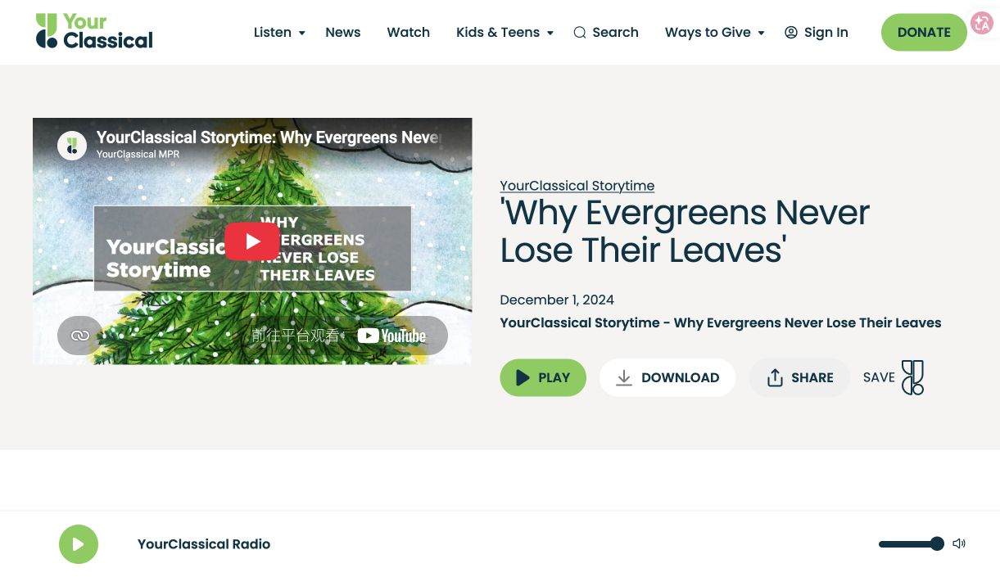
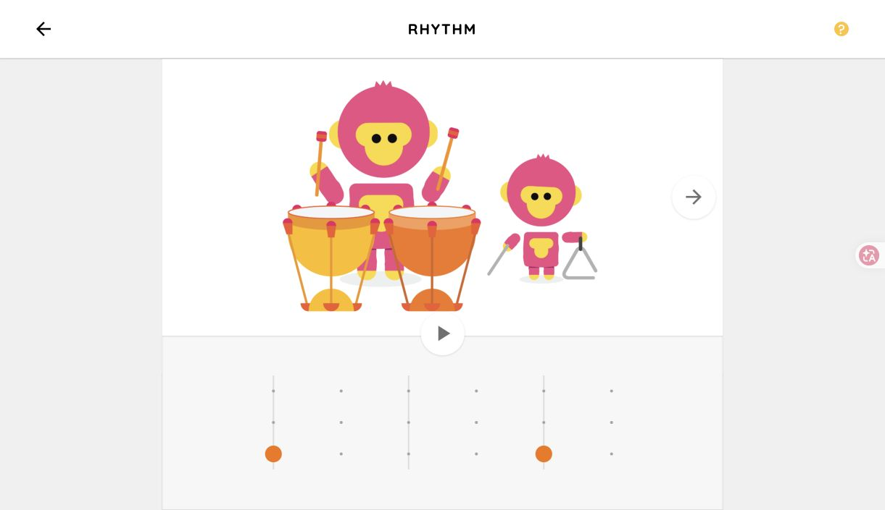

# Research Log 01 — Competitor Analysis

**Project:** MaestroMate — AI-Powered Interactive Classical Music Platform  
**Date:** 2026-10-15  
**Phase:** Phase 1 — Research & Requirements  
**Topic:** Existing Products & Competitor Analysis  
**Status:** Preliminary Research Completed
**Screenshots updated:** 2026-10-16

---

## 1. Research Objective

本次调研旨在分析现有古典音乐教育与数字音乐互动平台，重点考察其目标受众（Target Audience）、核心功能（Core Features）、设计优势与局限（Strengths & Limitations），并为 MaestroMate 的功能设计与技术开发提供参考。

MaestroMate 目前计划包含三个核心模块：

1. **AI Musician Conversation：** 与基于历史资料构建的虚拟古典音乐家进行互动交流。
2. **Interactive Music Theatre：** 结合音乐、视觉艺术与互动叙事，提供沉浸式音乐欣赏体验。
3. **Music Detective：** 通过音乐小游戏培养主动聆听（Active Listening）能力。

本次研究以产品官方网站和公开功能介绍为主要依据，属于初步桌面调研（Desk Research），尚未完成所有产品的实际交互测试。

2026-10-16 补充五个核心产品的实际官网截图，保存于本仓库并使用相对路径引用。截图用于记录界面与功能入口，不作为教学效果或完整交互测试的证据；页面与插画版权归原权利人所有。

## 2. Competitor Analysis

综合相关性与代表性，选择五个核心产品进行分析，并补充两个辅助参考案例。

### 2.1 MusiQuest — Character-Guided Music Learning

**Website:** https://app.musiquest.com/welcome  
**Introduction:** https://app.musiquest.com/how-it-works

*图 1：MusiQuest 首页：角色视觉与创作、课程入口。来源：[官方页面](https://app.musiquest.com/welcome)；截图日期：2026-10-16。*

**Target Audience:** 音乐初学者、儿童及青少年，以及教师和家庭学习者。

**Core Features:**  
MusiQuest 是一款游戏化音乐学习平台，将音乐理论、音乐创作、互动任务与虚拟角色结合。平台通过 Noties 虚拟角色引导用户学习，并提供 Song Builder 等音乐创作工具。课程包含探索、练习、反馈和挑战等环节。

**Strengths & Limitations:**  
平台的优势在于角色引导与学习流程的整合，能够使不同学习活动之间形成联系。但其主要重点是系统化音乐学习和创作，并非围绕古典音乐作品欣赏展开，整体课程体系也较为复杂。

**Implications for MaestroMate:**  
AI 音乐家不应只是独立聊天页面中的角色，还可以成为跨模块的引导者。例如，在对话中推荐作品，引导用户进入音乐小剧场，并关联相应的 Music Detective 活动。

### 2.2 Classics for Kids — Classical Music Education Through Games

**Website:** https://www.classicsforkids.com/  
**Music Games:** https://www.classicsforkids.com/music-games/

*图 2：Classics for Kids：按学习主题组织的游戏目录。来源：[官方页面](https://www.classicsforkids.com/music-games/)；截图日期：2026-10-16。*

**Target Audience:** 主要面向小学阶段的儿童，同时为教师和家长提供教学资源。

**Core Features:**  
网站提供古典音乐家介绍、音乐知识、音频节目及多种小游戏，包括 Match the Rhythm、Note Names、Instruments of the Orchestra 和 Composer Explorer。

**Strengths & Limitations:**  
其优势是将具体音乐知识与互动练习结合。例如，Match the Rhythm 通过聆听和重现节奏训练用户的节奏感，而不仅仅是考查理论知识。

从公开的网站结构来看，音乐家资料、音乐节目和游戏主要按照内容类别组织。对于希望围绕同一首作品连续探索的用户，跨活动联系仍有进一步设计的空间。

**Implications for MaestroMate:**  
Music Detective 应围绕明确的聆听能力（Listening Skills）设计，而非仅仅提供音乐知识选择题。

建议优先探索：
- Instrument Recognition：乐器识别
- Rhythm Reconstruction：节奏重建
- Motif Recognition：音乐动机识别

这些活动可以与用户刚刚欣赏的古典音乐作品相联系。

### 2.3 YourClassical Storytime — Music Appreciation Through Visual Storytelling

**Website:** https://www.yourclassical.org/kids  
**Storytime:** https://www.yourclassical.org/

*图 3：YourClassical Storytime：故事插画、视频与音频入口。来源：[官方页面](https://www.yourclassical.org/episode/2024/12/01/yourclassical-storytime-why-evergreens-never-lose-their-leaves)；截图日期：2026-10-16。*

**Target Audience:** 年轻听众、家庭及教育工作者。

**Core Features:**  
YourClassical Storytime 结合故事朗读、古典音乐和插画，为用户提供具有情境性的音乐欣赏体验。此外，YourClassical 的 Class Notes 提供面向学校的音乐教学资源。

**Strengths & Limitations:**  
其优势在于通过故事和视觉艺术，使古典音乐欣赏更加具体、生动。但 Storytime 主要提供预先制作的线性内容，用户通常按照既定叙事进行欣赏，主动选择和进一步探索的空间相对有限。

**Implications for MaestroMate:**  
Interactive Music Theatre 可以借鉴其音乐与艺术叙事的结合方式，同时加入适度的互动机制。

建议探索 Interactive Guided Listening：用户可以选择关注作品的历史背景、音乐特征或艺术情境，但应避免频繁打断音乐，保持欣赏体验的连续性。

### 2.4 Carnegie Hall Kids — Child-Friendly Interactive Music Exploration

**Website:** https://kids.carnegiehall.org/  
**Games:** https://kids.carnegiehall.org/games

*图 4：Carnegie Hall Kids：Rhythm Explorer 游戏入口。来源：[官方页面](https://kids.carnegiehall.org/games)；截图日期：2026-10-16。*

**Target Audience:** 主要面向儿童音乐探索者。

**Core Features:**  
平台提供 Rhythm Explorer、Tune Crafter、The Young Person's Guide to the Orchestra 等游戏，并通过动画、插画及互动界面介绍音乐知识。

**Strengths & Limitations:**  
其优势在于低门槛操作、儿童友好的视觉设计以及多样化互动形式。

但对于 MaestroMate 而言，仅仅增加动画、积分或奖励，并不能保证用户真正理解音乐。游戏形式仍需与具体的教育目标保持一致。

**Implications for MaestroMate:**  
网站应重视界面的直观性与易用性。Music Detective 的反馈不应只包含正确或错误，还可以提供重新聆听、声音对比以及必要的视觉提示。

### 2.5 Chrome Music Lab — Interactive Music Experiments

**Website:** https://musiclab.chromeexperiments.com/  
**Rhythm:** https://musiclab.chromeexperiments.com/Rhythm/

*图 5：Chrome Music Lab — Rhythm：角色、播放按钮与节奏网格。来源：[官方页面](https://musiclab.chromeexperiments.com/Rhythm/)；截图日期：2026-10-16。*

**Target Audience:** 音乐初学者及课堂学习者，也适合普通用户自由探索。

**Core Features:**  
Chrome Music Lab 通过简单的网页实验，让用户直接操作节奏、旋律和声音元素。例如，Rhythm 允许用户通过点击节奏网格组织声音，并立即听到结果。

**Strengths & Limitations:**  
其突出优势是低学习门槛和即时声音反馈（Immediate Audio Feedback）。用户可以通过反复操作直观理解音乐元素。

但平台主要关注抽象音乐概念，并不围绕具体古典音乐家、历史背景或完整作品组织学习内容。

**Implications for MaestroMate:**  
Music Detective 可以借鉴其“操作—聆听—反馈”的交互逻辑，让用户通过主动重建、比较和探索音乐，而不只是完成单次答题。

其使用的网页音频技术也值得在后续 Technical Feasibility Study 中进一步研究。

---

## 3. Supplementary References

| Platform | Website | Research Value |
|---|---|---|
| LSO Play | https://play.lso.co.uk/ | 通过不同演奏视角帮助用户观察管弦乐演奏，可参考其音乐信息可视化方式 |
| Classicals.de | https://www.classicals.de/ | 古典音乐录音与授权资源，可用于研究音频素材来源及版权问题 |

**LSO Play:** 提供了不同于艺术化叙事的视觉设计方向。Interactive Music Theatre 可以考虑将艺术场景与实际音乐特征的可视化结合，例如突出当前演奏的乐器或重复出现的音乐动机。

**Classicals.de:** 提醒我们区分音乐作品与具体录音的版权。即使某首古典作品已进入公共领域，其现代演奏录音仍可能受到版权保护。后续应为使用的音频素材记录具体来源、许可类型和署名要求。

---

## 4. Comparative Findings

| Design Dimension | Existing Approaches | Potential Direction for MaestroMate |
|---|---|---|
| Virtual Characters | 通过角色介绍知识、引导学习 | 让 AI 音乐家承担跨模块引导功能 |
| Music Appreciation | 故事、插画、视频与音乐结合 | 创建可主动探索的音乐小剧场 |
| Music Games | 乐器识别、节奏练习、音乐知识游戏 | 围绕具体聆听能力设计互动任务 |
| Learning Structure | 按课程、游戏或知识类别组织内容 | 围绕同一首作品连接三个模块 |
| User Experience | 低门槛操作、视觉引导、即时反馈 | 保持界面简洁，减少不必要的操作 |
| Content Management | 音乐家、作品、媒体资料分门别类 | 建立三个模块共享的音乐内容结构 |

### Key Finding

现有数字音乐教育平台已经广泛采用游戏化、虚拟角色、视觉叙事和互动音乐学习。因此，MaestroMate 不应仅仅依靠这些独立功能体现差异。

更值得探索的方向，是将三个模块围绕具体古典音乐作品进行整合，使用户能够从人物历史、艺术欣赏和主动聆听等不同角度探索同一首作品。

---

## 5. Proposed Design Decisions

根据本轮调研，提出以下四项初步设计建议。

### Decision 1 — Product Positioning

**MaestroMate should be a classical music exploration platform rather than a comprehensive online music course.**

项目重点应放在古典音乐欣赏与探索，而不是构建完整的音乐理论课程体系。

目标受众暂定为古典音乐初学者及年轻听众。学校音乐课、音乐工作坊和文化教育活动可以作为优先考虑的使用场景，同时保留个人自主探索的可能性。

具体年龄范围仍需在后续需求分析中明确。

### Decision 2 — Composition-Centered Exploration

建议采用以音乐作品为中心的内容组织方式（Composition-Centered Exploration），将三个模块连接起来。

例如，用户选择 Beethoven 的 Symphony No. 5 后，可以：

1. 通过 AI Conversation 了解音乐家及作品背景；
2. 在 Interactive Music Theatre 中欣赏作品；
3. 通过 Music Detective 识别作品中的节奏动机和音乐特征。

这种流程不必是强制的。用户仍可以根据兴趣自由进入不同模块。

### Decision 3 — Clear Functional Boundaries

| Module | Primary Objective | Initial Features |
|---|---|---|
| AI Musician Conversation | 探索音乐家及作品背景 | 人物选择、实时文字对话、历史资料检索 |
| Interactive Music Theatre | 互动式音乐欣赏 | 音乐播放、艺术场景、适度互动 |
| Music Detective | 培养主动聆听能力 | 乐器识别、节奏重建、动机识别 |

第一版暂不优先考虑复杂的 AI 人物动画、大规模分支剧情、排行榜和完整课程管理系统，以控制开发复杂度。

### Decision 4 — Shared Music Content Structure

三个模块应尽可能共享同一套音乐家与作品资料。

初步内容结构：

`Musician → Composition → Historical Context / Audio / Visual Assets / Listening Activities`

每首作品可以关联历史背景、录音、音乐特征、相关插画及小游戏内容。

这一设计有助于保证跨模块内容的一致性，并为后续系统扩展提供基础。

以上均属于初步设计建议，尚未完成技术可行性和用户需求验证。

---

## 6. Open Questions

本次调研仍有以下问题需要进一步解决。

**1. Target Users & Usage Scenarios**

需要明确主要用户的年龄、音乐基础和设备使用条件，并判断课堂、工作坊或自主探索中哪种场景应作为优先开发目标。

**2. Interactive Music Theatre**

需要进一步研究视觉呈现与音乐内容之间的关系，明确哪些互动能够支持欣赏，哪些可能干扰用户聆听。

**3. Content Selection**

需要选择适合三个模块共同使用的音乐家和作品，同时考虑其教育价值、视觉表现空间以及音频素材的授权情况。

**4. Technical Feasibility**

需要评估 LLM、RAG、Web Audio API、动画框架等技术的实现成本，以及系统整体开发范围。

**5. Further Product Verification**

部分产品尚未完成实际交互测试。后续可以针对 MusiQuest、SFS Kids 和其他代表性产品进一步观察其用户流程、反馈机制和模块衔接。

---

## 7. Research Conclusion

本次竞品调研表明，现有数字音乐平台已经提供较为丰富的音乐游戏、视觉故事、角色引导与互动学习机制。这些产品为 MaestroMate 提供了重要的功能和交互设计参考，同时也说明，单纯增加类似功能并不足以形成明确的产品特色。

**MaestroMate 值得进一步探索的核心方向，是以古典音乐作品为中心，整合历史音乐家对话、艺术化音乐欣赏与主动聆听游戏。**

其中，AI Musician Conversation 帮助用户理解音乐家及作品背景，Interactive Music Theatre 提供音乐与视觉艺术体验，Music Detective 则引导用户发现音乐中的结构和声音细节。

这种整合式设计可以作为第一版原型的主要方向，但其实际价值和技术可行性仍需通过后续研究与开发验证。

---

## 8. Next Steps

**Completed**
- [x] 收集并筛选代表性音乐教育与古典音乐平台
- [x] 分析核心产品的受众、功能及相对局限
- [x] 总结可借鉴的交互设计
- [x] 提出初步产品定位与模块设计建议

**Upcoming**
- [ ] Research Log 02 — Target Users & Usage Scenarios
- [ ] Literature Review
- [ ] Technical Feasibility Study
- [ ] Ethics & Copyright Analysis
- [ ] Requirements Report
- [ ] Preliminary System Architecture

**Next Priority:** 明确 MaestroMate 的主要使用者、真实使用场景及核心用户需求，并将竞品分析中提出的设计建议进一步转化为具体的 Functional Requirements。
