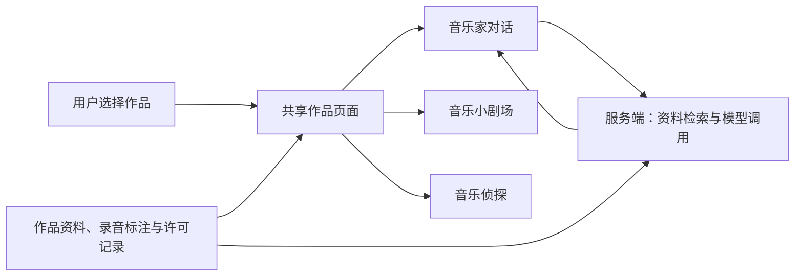

# MaestroMate｜第一阶段研究与需求整理

**阶段：** Phase 1 — Research & Requirements  
**更新：** 2026-10-27  
**状态：** 阶段汇报草稿，待审核。竞品与文献已有初步成果；本次补充技术、版权与伦理的桌面研究，以及需求和架构草案。尚未进行用户访谈、功能实测或教学效果实验。

## 1. 项目方向与初步需求

MaestroMate 拟以**同一部古典音乐作品**连接人物背景、艺术化欣赏和主动聆听，让用户从不同入口探索音乐。保留原定的三个模块：

| 模块 | 核心用途与初版范围 | 后续原型应能展示 |
|---|---|---|
| AI Musician Conversation｜音乐家对话 | 以历史音乐家为虚拟引导者，回答作品背景问题，推荐相关欣赏和聆听活动；先采用文字交流 | 回答关联资料出处；资料不足时明确说明；可进入同一作品的其他模块 |
| Interactive Music Theatre｜音乐小剧场 | 结合音乐、原创或获许可的艺术场景和适度互动，提供作品欣赏体验 | 播放、暂停、回听；艺术场景或结构提示与作品对应，提示可关闭 |
| Music Detective｜音乐侦探 | 通过片段比较、节奏或动机识别，引导用户注意声音细节 | 用户先判断，随后得到解释及对应回听入口，而非只有对错 |

第一版建议用**一位音乐家、一部作品**展示三个模块的联系。完整课程、复杂人物动画、大规模分支故事及排行榜留待后续评估。这是范围建议，不代表最终需求已被用户验证。

用户年龄暂不确定。先保留“教师引导的课堂／工作坊”和“初学者自主探索”两类候选场景，后续结合实际聆听困难、所需帮助、设备条件和可接触的参与者决定。竞品面向儿童不构成选择儿童的充分理由。

## 2. 已有研究支持什么

**竞品方面：** 已比较 MusiQuest、Classics for Kids、YourClassical Storytime、Carnegie Hall Kids 和 Chrome Music Lab，并补充 LSO Play 与 Classicals.de。角色、故事、视觉和游戏已是常见做法；本项目值得探索的是围绕同一作品组织这些活动，使背景理解、欣赏与声音观察相互联系。这个组合的教育价值仍需验证，不能据有限竞品样本宣称市场上没有类似产品。官网、截图及逐项分析见[竞品报告](./competitor%20analysis.md)。

**文献方面：** 初轮整理七项研究，本轮复核其中两项并新增三项原始研究。可保留的设计依据是：互动需要引导比较、解释和回听；视觉与故事应服务具体体验或学习目标；AI 应提供有依据的引导。现有研究不能证明动画必然更有效，也不能证明历史人物角色或三个模块整合必然提升音乐理解。[初步综述](./literature-review.md)

**本轮修正：** 全文核查后，降低了一项听赏图研究的效果证据权重；另一区分是“有图时能答对”和“撤去提示后仍能听辨”。完整方法审查保存在[听赏图研究附录](./2026-10-27-listening-maps-review-draft.md)。它是音乐小剧场与音乐侦探的设计依据之一，不取代项目的整体方向。

后续评价同时关注**作品背景理解、主动聆听和使用体验**。可先用一个短片段比较任务检查流程是否清楚，再分别评价独立判断与兴趣；当前没有 MaestroMate 的学习效果数据。AI 历史角色的额外教学价值仍是文献缺口，一般 AI 辅导研究不能替代这项证据。

## 3. 技术可行性与初步架构

官方技术资料支持下列候选实现路线；这里的“可行”指存在相应技术机制，尚不代表本项目已完成集成或通过设备测试。

| 部分 | 建议路线 | 主要工作与限制 |
|---|---|---|
| 音乐播放与互动 | 普通音频播放、暂停和定位先用浏览器媒体能力；需精细节奏调度或声音处理时再引入 Web Audio API | 片段和提示位置按具体录音人工标注；播放状态与视觉同步仍需测试 |
| 小剧场与侦探 | 页面图形、轻量动画及规则明确的题目，共用同一录音与标注 | 先采用已审核的音乐特征与答案；首版不依赖自动音乐分析 |
| 音乐家对话 | 经审核的资料库＋检索相关段落＋语言模型生成回答，回答附可核对出处 | 资料整理、事实评阅和错误处理是主要工作；检索不能保证消除编造 |
| 内容与运行 | 少量作品先用结构化内容文件；模型请求由服务端处理，密钥留在服务端 | 记录作品、录音版本、活动、来源与许可；规模增加后再决定是否引入数据库 |

浏览器媒体接口允许读取播放位置及跳转；但播放时间是近似值，不能把定时刷新当作精确节奏同步。[MDN：播放位置](https://developer.mozilla.org/en-US/docs/Web/API/HTMLMediaElement/currentTime) 音频通常应由用户点击启动，需处理浏览器自动播放限制。[MDN：Web Audio 最佳实践](https://developer.mozilla.org/en-US/docs/Web/API/Web_Audio_API/Best_practices)

检索增强生成（RAG）结合外部检索材料与生成模型，可作为对话的候选路线；是否适合本项目的小型资料集，要通过实际问答检查，而非预先认定必须使用复杂检索系统。[Lewis 等：RAG 原始论文](https://arxiv.org/abs/2005.11401)

**初步判断：** 保持三个入口、减少首批内容量，是较可控的原型路线。技术风险集中在音频与画面同步、模型回答质量、外部服务访问及素材准备。运行成本由模型用量、音频流量和托管构成；模型服务商、网络可达性、响应时间与实际费用均未实测，目前不填写未经验证的预算。下一次技术试验应同时检查三模块衔接、音频回听和一组有出处的代表性问答。

## 4. 版权、内容与研究伦理

**版权要落实到具体版本和使用方式。** 乐曲、改编与乐谱、表演和录音可能涉及不同权利；作品年代久远不等于某个现代录音可以直接使用。教学和科研用途也有条件，不能自动延伸为公开网站或公开 GitHub 仓库中的自由传播。[《著作权法》第 13、24、39、44 条](https://www.ncac.gov.cn/xxfb/flfg/flfg_532/202103/t20210309_50530.html)

本次以原计划中的贝多芬第五交响曲为**候选素材例子**，核查了 Classicals.de 的具体作品页：

| 候选素材／版本 | 页面公开标示的演奏者与许可 | 对项目的影响 |
|---|---|---|
| 第五交响曲现场管弦乐录音 | The Fulda Symphonic Orchestra；2002-03-10；CC BY-SA 4.0 | 保留署名、来源与许可链接，并注明修改；结合动画时需进一步判断演绎内容及相同方式共享的范围 |
| 同页第一乐章钢琴改编录音 | Gregor Quendel；CC BY-NC 4.0 | 有非商业用途限制，不能视为与现场录音相同的授权 |

两条记录来自[同一官方作品页的录音说明](https://www.classicals.de/beethoven-symphony-no5)，核查日期为 2026-10-27。CC BY-SA 要求对演绎内容按规定共享；许可正文还专门规定音乐或录音与动态图像按时间同步会产生演绎材料。这关系到小剧场的素材选择，但不能直接推断所有网站代码都必须采用该许可。[CC BY-SA 说明](https://creativecommons.org/licenses/by-sa/4.0/deed.zh-hans)｜[许可正文 §1(a)、§3](https://creativecommons.org/licenses/by-sa/4.0/legalcode.en) CC BY-NC 则另有非商业条件。[CC BY-NC 说明](https://creativecommons.org/licenses/by-nc/4.0/deed.zh-hans)

以上是**页面许可初查**，尚未下载或使用音频，也未完成具体文件、完整署名信息及计划用途的最终核验。网站也提示需按所在地法律检查版权状态。[平台授权说明](https://www.classicals.de/licensing) 因此该作品仍为候选，不作为已清权的最终素材。采用时应留存版本、原始链接、许可及核查日期，并记录截取、剪辑和动画配合方式。

**图片与文字：** 产品优先采用原创或有适用许可的素材；历史资料应自行整理并给出出处，不整段搬用现代传记。已有竞品截图继续单独保存在 `assets/screenshots/`，用于报告中的界面评论，署名不等于授权；不把竞品插画转用作产品素材。公开展示截图的必要性与引用范围仍需结合实际使用检查。

**AI 与参与者：** 音乐家应清楚标为基于历史资料的虚拟角色；区分史实与创作表达，不将生成内容包装为历史原话。NIST 指出生成式 AI 可能自信地给出错误内容和虚构引文，因此出处也要人工核对。[NIST 生成式 AI 风险说明 §2.2](https://nvlpubs.nist.gov/nistpubs/ai/NIST.AI.600-1.pdf)

原型建议先不设账户，不主动收集身份信息；如研究需要记录回答，应事先说明用途、保存期限、访问权限与退出方式。接入模型前核查服务方对输入的保存和处理方式，不将参与者身份资料放入对话。若招募未成年人，应按学校研究要求办理相应流程；在中国处理不满十四周岁未成年人个人信息还涉及监护人同意及专门规则。[《个人信息保护法》第 6、19、31 条](https://www.cac.gov.cn/2021-08/20/c_1631050028355286.htm)

## 5. 阶段结论与后续安排

目前可以提交的是：竞品分析、初步文献证据，以及本报告中的需求、技术路线、架构和版权伦理草案。**第一阶段的桌面研究已有整体框架，需求确认和实际验证仍未完成。**

| 原定工作方向 | 本阶段已有成果 | 接下来补齐 |
|---|---|---|
| 竞品与文献研究 | 产品比较、原始出处、文献边界及听赏图证据修订 | 按设计问题定向补充 AI 角色及自主音乐探索证据，避免无目的扩充文献 |
| 用户与需求 | 三模块用途、首版范围和候选场景 | 接触候选用户，了解真实困难，确认优先用户与功能 |
| 技术与架构 | 候选实现路线、共享内容结构及风险判断 | 做一首作品的流程原型，实测播放、问答、设备与费用 |
| 版权与伦理 | 权利层次说明、两种录音许可初查、内容与数据原则 | 确定素材并逐项核验；按实际参与者和服务商完善研究安排 |

明天与老师讨论的重点集中在**项目定位是否合适、首版内容与功能范围是否可控、哪类用户和场景便于开展研究**。讨论后，先确定一部作品及合法可用的素材，形成三个模块相连的任务样例，再结合用户反馈和技术试验收敛需求。

详细证据分别留在竞品报告与文献记录中；阶段汇报以本文件为主，截图继续单独存放。

