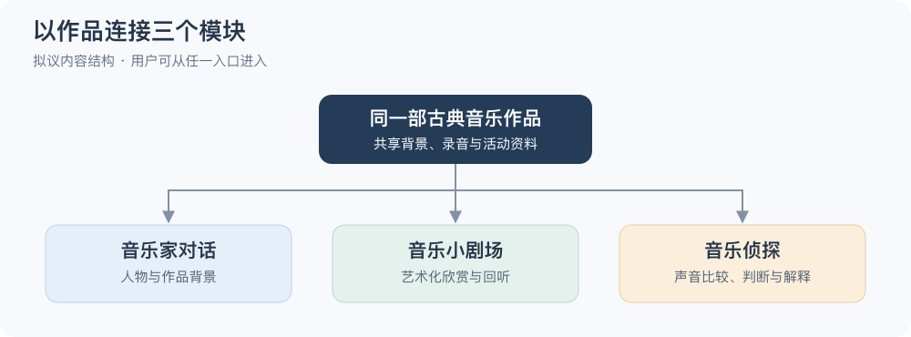

# MaestroMate｜第一阶段研究总结

**Phase 1 — Research & Requirements｜2026-10-28｜研究初稿**

本阶段围绕一个问题展开：怎样让古典音乐的背景解释、艺术化欣赏和主动聆听在同一部作品中形成联系？目前已整理五项并列研究，形成产品方向、需求与系统方案的初稿。判断依据来自竞品、文献和技术资料，尚未开展用户访谈、原型实测或教学效果实验。

*拟议内容结构；三个入口可自由选择，整合效果仍待验证。*

## 一、五项研究形成了哪些判断

| 研究 | 主要结论与正文 |
|---|---|
| [竞品研究](./competitor%20analysis.md) | 角色、故事和游戏已有多种实现；本项目重点考察同一作品下的活动联系 |
| [文献研究](./literature-review.md) | 比较、解释和回听有设计依据；视觉跟随、兴趣与独立学习应分别评价 |
| [用户与需求分析](./target-users-and-scenarios.md) | 从实际困难、音乐经验和支持条件确定用户；年龄暂缓定案，需求由后续调查修订 |
| [技术与系统方案](./technical-feasibility.md) | 共享作品资料、人工音频标注与轻量视觉可构成首版路线；模型表现及费用需实测 |
| [版权与伦理研究](./ethics-and-copyright.md) | 许可落实到具体录音和用途；虚拟角色、史实出处和参与者数据需要明确处理 |

## 二、阶段判断与后续工作

三个模块可以保留，但首版宜收小内容量：以一位音乐家、一部作品和少量活动检查整体体验。音乐家对话帮助理解背景，小剧场组织欣赏与回听，音乐侦探引导用户注意声音细节。作品与素材的选择将同时影响教育内容、视觉设计和开发工作量。

当前证据支持这些方向进入原型探索，尚不能证明整合方案具有教学优势，也不足以决定最佳年龄。研究中已修正一项听赏图论文的证据权重，并补入相近的历史角色研究；详细核查保留为[文献附录](./appendix/listening-maps-evidence.md)，不再单列为阶段任务。

后续优先确认使用场景和首版范围，再选定作品与可用素材，结合用户反馈检查任务，测试音频与问答。素材最终核验在使用前完成，参与者与数据安排在招募前落实。
