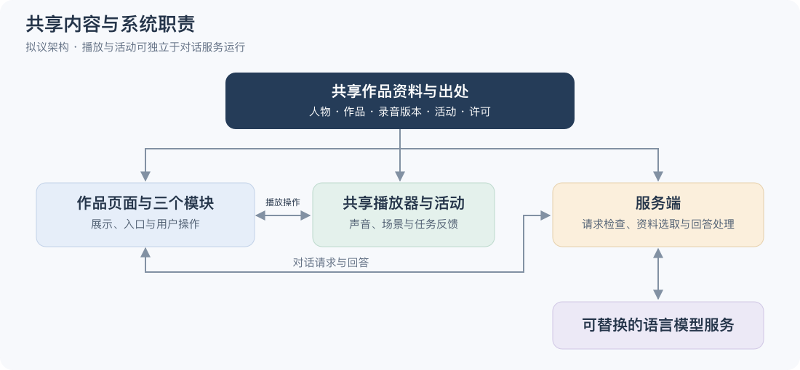

# 技术与系统方案

**MaestroMate｜第一阶段研究｜研究初稿，2026-10-28**  
基于官方技术资料与原始研究作初步评估，合并技术路线和架构设计；尚未进行模型调用、设备或费用实测。

## 一、让技术范围与首版内容相称

首版需要检验的是同一作品下三个模块能否形成连贯体验。这个范围允许先采用审核过的资料、人工音频标注和轻量视觉呈现，将开发工作集中在播放、反馈与内容衔接。

| 部分 | 候选路线 | 选择理由与主要约束 |
|---|---|---|
| 音乐家对话 | 按作品选取资料，再由模型生成带出处的回答 | 少量内容可先用简单检索；资料与回答仍需审核 |
| 音乐小剧场 | 浏览器播放器、二维场景和人工时间标注 | 可控制制作量；提示位置必须绑定具体录音版本 |
| 音乐侦探 | 预设片段、经核对的答案及解释 | 先验证活动设计；自动音乐分析另行评估 |
| 共享内容 | 结构化文件连接作品、录音、活动及来源 | 首批内容量较小，可先避免复杂数据库维护 |

浏览器媒体接口支持播放位置读取和跳转，但位置是近似值，不能直接视为精确节拍。若后续需要节奏合成或更细的声音调度，可再引入 Web Audio API。[媒体时间](https://developer.mozilla.org/en-US/docs/Web/API/HTMLMediaElement/currentTime)｜[Web Audio](https://developer.mozilla.org/en-US/docs/Web/API/Web_Audio_API) 浏览器也可能限制自动发声，因此播放应由明确的用户操作启动，并处理加载失败。[最佳实践](https://developer.mozilla.org/en-US/docs/Web/API/Web_Audio_API/Best_practices)

对话可参考检索增强生成（RAG），结合外部资料与语言模型。[原始论文](https://arxiv.org/abs/2005.11401) 该机制提供了资料接入方式，事实准确性仍取决于资料质量、检索结果和回答处理。是否采用向量检索，应由资料规模及实际问答决定。

## 二、三个模块共享什么

*图示为拟议架构，尚未实现或部署；连线表示内容依赖或请求往返。*

网页负责作品展示、播放器和活动反馈；服务端管理密钥、请求限制、资料选取及模型调用。对话服务不可用时，已有介绍、音乐播放和确定性活动仍应能够使用。这样可以把模型服务的不确定性限制在对话环节。

| 内容对象 | 关键记录 | 对设计的意义 |
|---|---|---|
| 音乐家与作品 | 标识、介绍、背景条目、事实出处 | 三个模块围绕相同内容展开 |
| 录音 | 版本、演奏者、来源、时长、许可 | 区分同一作品的不同演奏和授权 |
| 提示与活动 | 录音标识、起止点、题目、解释、审核状态 | 让场景、回听与答案指向准确片段 |
| 来源与权利 | 原始链接、许可、署名、核查日期和用途 | 支持内容更新及使用前核验 |

用户选择作品后，页面读取对应录音和活动。暂停、重播或跳转时，画面根据实际播放位置更新。对话请求则携带作品标识，由服务端选取资料并返回回答及出处。检查引用编号只能排除无效条目，回答是否正确仍需要语义核对与人工评阅。切换模块保留作品和录音标识，避免出现内容错配。

## 三、开发约束与验证安排

内容准备是首版的重要工作量：事实核对、录音许可、时间标注和活动答案都需要人工处理。服务商选择还需考虑使用地区、响应时间和输入保存方式。当前没有实测依据，不能确定最终预算或承诺设备表现。

运行费用由模型调用、媒体传输、托管和必要授权构成。作为规划示例，若 100 次体验各有 8 轮对话，每轮平均输入 2,000、输出 250 tokens，则约需 160 万输入和 20 万输出 tokens；这里已将所发历史与资料计入输入。若每百万 tokens 的输入、输出单价为 P、Q，模型费用约为 `1.6P + 0.2Q`。实际用量、重试与缓存会改变结果，这一估算用于后续询价，不能代替报价。

原型优先检查三件事：模块切换是否仍对应同一作品；暂停与回听后音画是否一致；代表性问答能否找到支持回答的资料。核心操作还应支持键盘，播放状态有文字说明，错误有恢复入口。[W3C 键盘要求](https://www.w3.org/WAI/WCAG22/Understanding/keyboard.html) 密钥留在服务端，账户与长期聊天保存暂不纳入首版；数据处理原则见[版权与伦理研究](./ethics-and-copyright.md)。

现有技术资料支持进入小规模原型验证。前端框架、部署平台与模型服务商将在上述约束下选择，复杂三维人物和自动音乐分析可随已验证需求逐步评估。
